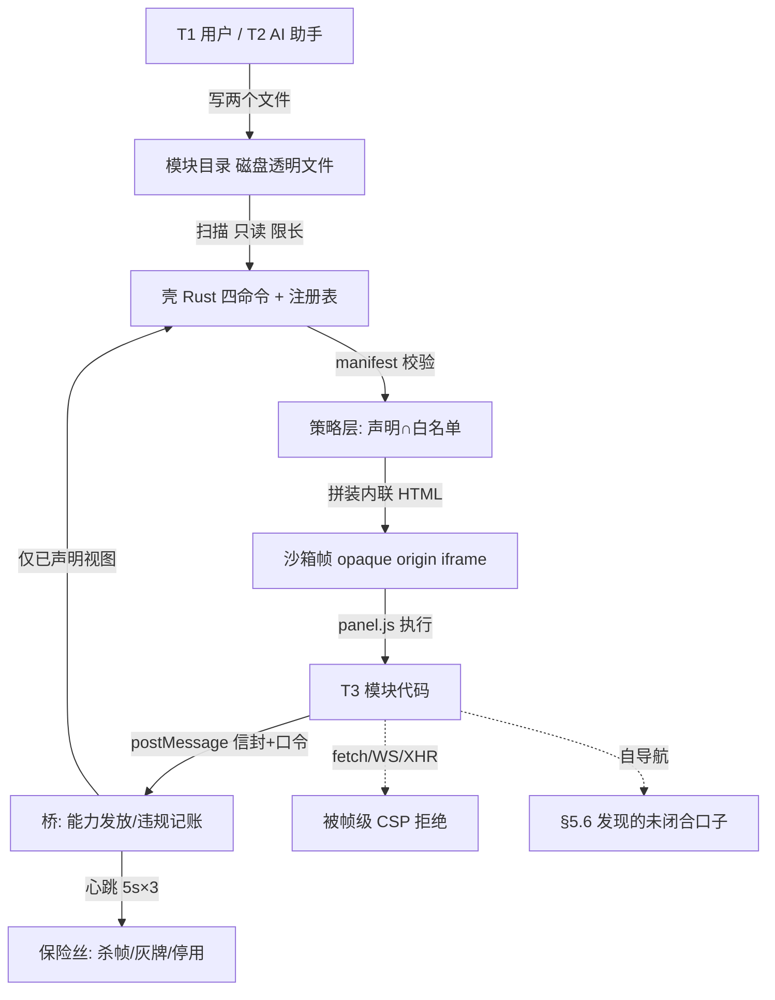

# 让 AI 与第三方自写扩展：桌面应用的声明即契约沙箱模型与对抗审计

*（初稿 · 待管理员/合作者审；投稿定位：软件安全方向「经验报告 / 案例研究」类长文，非新机制类论文）*

**投稿版说明**：本文所有实证材料来自 **Inkglean（拾绘）**——一款 Windows 桌面应用（Tauri 2 + WebView2 + Vue 3 + Rust，本地优先、面向单一非技术职业用户群，后文统一称 Inkglean）的真实设计—施工—审计记录，时间跨度约为 8 月下旬至 9 月中旬（保留相对顺序、精确到日以规避可反查风险）。实证产品名经用户授权对外实名；绝对路径、示例模块专有名、内部工单与批次编号、私有代码文件与行号均已在本稿替换为泛化描述或语义标签。逐条数字的内部复算映射（记录 ↔ 证据文件与行）随返工账另行留存、不入库；公开稿以语义标签与附录 A 的行锚点指代，外部先例标为 [R#]，二者在参考文献分列。

---

## 摘要

**问题.** 当桌面应用把「写扩展」这件事同时开放给**用户的 AI 编程助手**和**第三方小工具作者**时，扩展代码的作者从「经过选择的开发者」变成了「任何能往磁盘丢两个文件的人」。传统扩展安全模型（宿主进程内执行 + 安装时权限弹窗 + 人工审核）在这一威胁主体下失效：作者身份不可辨识、代码未经审阅、修改随时发生、且扩展天然能读到宿主里的敏感个人数据。

**方法.** 我们在一个封闭域桌面产品上落地了一套**声明即契约 + 实现依托**的沙箱模型：扩展（「模块」）以 `manifest.json` 声明其联网/读写/数据视图订阅/联动/后台运行五类能力并附人话理由，壳（宿主）在运行时按声明发放能力、越权即记账、累计即停用；而每条禁令都被翻译成一条壳侧的强制机制。模型分四层：不透明源（opaque origin）沙箱帧载体、声明与白名单驱动的能力发放、信封握手桥协议、可用性保险丝与四态状态机。规范与实际实现各经历一轮红队内攻（5 高危 / 9 中危 / 4 低危，24 项裁决 23 属实 / 1 部分属实 / 0 编造）、一轮六家公开插件系统对照、一轮第三方 AI 研判（十条中 8 条已覆盖、采纳 2、留门 2、纠正 1）、一轮文档↔代码回写、一轮真机走查、一轮外部只读审计的逐条回代码核实。

**结果.** 该模型自 8 月下旬起以一批五件完整落地，桌面端测试基线在该批从 130 增至 185（模块机制专项净增 52 例为可核推导值；须强调 185 是**全应用**测试总数、非沙箱专项数）。审计链上暴露两处真实缺陷：(1) 壳→模块的数据下发形式用错，使官方示例模块自落地那天起就永远显示灰牌（占位失败态），而 **185 条测试全绿无一抓到**，仅由保险丝按设计兜住可用性——由真机走查发现（9 月上旬）；(2) 帧级 CSP 只写了 `connect-src 'none'`、未写导航类指令，**第三方模块可自行导航沙箱帧把客户名/金额/截止日期带出本机**，哪怕它「声称不联网」——此条由外部审计（9 月中旬）提出、回代码核实为真（P0 级：帧构造处无导航类指令、账本视图下发含敏感业务字段），自家三轮审计均未抓出。修法是从数据源头切断（第三方模块不再取得账本视图，仅第一方/官方可取，补 24 条安全用例），Rust 侧导航拦截作为纵深第二层留待真机专项。

**结论（诚实定位）.** 本文**不宣称发明任何隔离原语**：iframe `sandbox`、不透明源、帧级 CSP、声明式权限清单、心跳看门狗在公开界均有充分先例 [R1–R12]。贡献有三：①把「AI 与第三方可自写扩展」当作**新的威胁主体**做了一遍完整的风险建模，并给出三条低成本、高收益的设计约束（不热更、身份性字段一律壳判、模块文案按不可信输入处理）；②给出一条可迁移的反直觉教训——**「物理断网」这类命名的强度必须与其覆盖闭包一致**，W3C CSP 标准早已明写「外泄缓解能力取决于最宽的那条指令」[R5]，而我们在实践中恰恰把 `connect-src` 当成了全部，被后轮审计抓出；③提供一条**含漏判与补刀的完整多轮对抗审计实证链**：自家红队找「承诺与实现之间的缝」，外部审计找「实现与现实之间的缝」，二者不可互相替代，而「测试全绿」既不能证明功能正确也不能证明安全边界成立。

**关键词.** 扩展安全；沙箱；不透明源；内容安全策略；声明式权限；AI 生成代码；对抗审计；桌面应用；隐私

## Abstract

*When a desktop application opens extension authoring to the user's own AI coding assistant and to third-party tinkerers, the population of extension authors changes from "curated developers" to "anyone who can drop two files on disk". The conventional extension-safety stack (in-process execution, install-time permission prompts, human review) breaks down under this threat actor: authors are unidentifiable, code is unreviewed, edits happen at any time, and extensions sit on top of sensitive personal data.*

*We report the design, implementation and multi-round adversarial audit of a **declaration-as-contract** sandbox in a closed-domain Windows desktop product (Tauri 2 + WebView2). Each extension declares five capability groups plus a human-readable rationale in a manifest; the shell grants exactly the declared subset and suspends an extension after a rolling violation budget. Every prohibition is paired with an enforcement mechanism ("teeth") in four layers: an opaque-origin iframe carrier, manifest-and-allowlist driven capability issuance, a tokenised envelope bridge, and availability fuses with a four-state lifecycle. Audits comprised an internal red team (5 high / 9 medium / 4 low findings; 24 adjudications: 23 confirmed, 1 partially, 0 fabricated), a six-vendor comparison of public plugin systems, a third-party AI review (8 of 10 rules already covered, 2 adopted, 2 deferred, 1 corrected), a documentation-to-code reconciliation, an on-device walkthrough, and an item-by-item re-verification of an external read-only audit report against the code.*

*Two real defects survived our own review: a broken shell→extension data path that left the official sample module permanently in its placeholder failure state while **all 185 desktop tests passed** (found only by manual walkthrough), and — reported externally and confirmed as P0 — a **frame self-navigation exfiltration channel**, because the frame CSP specified only `connect-src 'none'` and no navigation directive, letting a "non-networked" third-party module leak client names, amounts and deadlines off the machine. The fix removes the data at its source (ledger view is no longer issued to third-party modules) plus 24 security test cases, with a Rust-side navigation interceptor deferred as defence-in-depth requiring on-device verification.*

*We claim no new isolation primitive: iframe sandboxing, opaque origins, per-frame CSP and declarative permissions are all well documented. The contributions are a threat model for AI-authored extensions with three cheap design constraints, a transferable lesson that the naming strength of a control must match its directive coverage (as W3C CSP Level 3 already states), and an honest audit chain that includes both our miss and someone else's catch.*

**Keywords.** extension security; sandboxing; opaque origin; Content Security Policy; declarative permissions; AI-generated code; adversarial audit; desktop applications

---

## 1. 问题：AI 自写扩展是一个新的威胁主体

### 1.1 场景

Inkglean 是一款本地优先的个人业务管理桌面应用，主用户是**单一职业的非技术个体创作者**：一台 Windows 机器、一个用户、数据全在本机，产品对用户的明文承诺是「数据永不上传」〔红队审计与规范评审记录〕。产品的插件化路线原本被否掉过——内部研判的核心理由是「用户不是开发者」，开放生态的需求证据为零〔红队审计与规范评审记录〕。

这个前提被用户亲述的四条动因推翻〔红队审计与规范评审记录〕：

1. **用户会用 AI 自己写模块**——模块就是磁盘上的两个透明文件（`manifest.json` + `panel.js`），AI 编程助手直接改文件即可完成开发，不需要应用内编辑器；
2. 服务端变更后希望**单个模块单独失效 / 单独更新**，而不是整包发版；
3. 板块自由开关；
4. 远期可能开小商店（「留门不修路」）。

由此，「原论据（用户不是开发者）就此作废」被明确写回内部文档〔红队审计与规范评审记录〕。这一步不是产品口味变化，而是**威胁主体的变化**：扩展代码的作者从「可识别、可追责、经审阅的开发者」变成「用户 + 用户的 AI + 社群里传过来的陌生文件」，其中：

- **作者不写代码也不读代码**：签名者、审阅者、运行者三者彻底分离；
- **代码由机器量产**：AI 生成的代码量大、风格雷同、缺陷呈系统性（公开测量：对 1,692 个 Copilot 补全程序的评估中约四成含可映射 CWE 的漏洞 [R13]；另有研究对公共仓库中标注为 AI 生成的代码做大规模静态扫描，同样报告了相当比例的漏洞与多种 CWE 实例 [R14]）；
- **修改随时发生且不留痕**：模块文件在磁盘上，AI 一次改写即生效（下一次启动），没有提交、没有评审、没有版本协商；
- **传播绕过一切审核渠道**：内部文档当时即如实提示「模块文件天然可被用户间互传，信任边界会悄悄漂移」〔红队审计与规范评审记录〕。

### 1.2 为什么既有模型不够用

对照三类公开模型：

| 模型 | 假定 | 对 AI 自写扩展是否成立 |
|---|---|---|
| 宿主进程内扩展（IDE 类）：扩展与应用同权运行，靠安装来源与发布者信誉约束 | 作者可辨识、代码可审、市场可下架 | 否。官方缓解建议本身是「只装可信发布者的扩展 + 扩展允许清单」[R1]，对「本机自写、永不上架」的模块无从适用 |
| 工作区信任（IDE 类的 Restricted Mode）：静态声明扩展在未受信工作区能否运行 [R2] | 被治理对象是**工作区内容**，不是扩展自身 | 否。它不解决「扩展本身不可信」这一维度 |
| 笔记/知识工具插件：官方明写插件**没有沙箱隔离**、继承应用访问级别，默认用受限模式挡在门外 [R6][R7] | 用户主动放弃隔离换取功能 | 与本文目标冲突：我们要的是「用户不需要是开发者，也能安全地开」 |

结论：在「扩展由 AI/第三方就地自写、不经过任何发布审核」的场景里，安全承诺不能建立在**身份、审核、撤销**上，只能建立在**运行时不可越过的机制**上。这就是本模型的出发点。

### 1.3 设计哲学（未随审计改变）

四条口径从规范 v0.1 到落地实现一字未动〔红队审计与规范评审记录〕：

> **声明即契约 · 越权即停用 · 最小够用 · 人话可见**

本文的工程论点是：**这四条中的前三条，若没有「实现依托」（enforcement teeth）与之配对，就只是贴在墙上的告示**。红队给出的原话是：「原规范只写了『不许做什么』，没写『壳靠什么保证它做不到』……这就像小区贴了『禁止翻墙』的告示，但没修墙」〔红队审计与规范评审记录〕。

---

## 2. 威胁模型

### 2.1 主体与能力假设

| 主体 | 能力 | 意图假设 |
|---|---|---|
| **T1 用户本人** | 在模块目录放/改文件；在管理页启用停用；配置模块设置项 | 善意，但**不读代码** |
| **T2 用户的 AI 助手** | 与 T1 等价的写文件能力（工具调用即写盘） | 无稳定意图；产出正确性不保证；可被提示注入操纵（间接） |
| **T3 模块代码（自写或外来的）** | 在壳给定的执行环境内运行任意 JS；控制自己那格 UI；通过桥发消息 | **对抗性**（本文按最坏情况分析：可能是恶意 AI 产物或被篡改的第三方文件） |
| **T4 模块文件传播者** | 把文件递进 T1 的机器（群、网盘） | 可对抗性；不接触壳、不接触更新通道 |
| **T5 远端攻击者** | 若模块取得网络或可影响导航，则可接收外泄数据、下发后续载荷 | 对抗性 |

**壳（宿主）** 被假定为可信且正确实现其判定逻辑；**本机文件系统中已有读权限的攻击者**（已能直接读数据库文件）不在防御范围内。

### 2.2 攻击目标（对抗者视角）与对应防线

| # | 攻击目标 | 具体手段设想 | 防线（机制编号见 §4） |
|---|---|---|---|
| G1 | **越权取得数据** | 未声明订单/账本视图却取用；或声明 A 视图套取 B 数据 | M2 视图白名单 + M2 防借道（订阅带数据事件须先声明对应数据）〔红队审计与规范评审记录〕 |
| G2 | **数据外泄** | 直接 `fetch`/XHR/WebSocket 绕过桥；`img`/表单/导航把数据编进 URL；取得任何原生 IPC | M1 不透明源帧 + M1' 帧级 CSP 断传输型 API + M3 白名单外记违规 + **（事后补）M6 从源头不发敏感视图** |
| G3 | **权限与身份伪造** | 模块自报 `source:"official"`；自报「可撕出悬浮窗」；自报能力档位 | M4 身份性字段一律壳判，模块自报无效（`source` 由更新通道签名认定；`tearable` 被壳压 false）〔红队审计与规范评审记录〕 |
| G4 | **可用性绑架** | `while(true)` 死循环冻住首页；加载不返回 | M5 独立帧 + 心跳 5s×3 杀帧 + 加载 5 秒灰牌〔施工与门禁记录〕 |
| G5 | **界面注入 / 文案攻击** | manifest 文案里塞脚本、塞一万字、塞越权承诺 | M7 转义纪律：一切来自模块的文本按不可信输入处理，插值转义 + 限长，永不 `v-html`〔施工与门禁记录〕 |
| G6 | **越界写** | 写库、写凭据、写别人的模块目录、路径穿越 | M8 壳侧只读四命令 + 目录名白名单（拒「.」开头）+ 目录名须等于 id + 同 id 后到拒载〔施工与门禁记录〕 |
| G7 | **静默生效** | 改文件后立即接管；或改坏后无限重试拖垮首页 | M9 不热更（下次启动生效）+ 灰牌重试一次再崩转停用 |
| G8 | **资源滥用** | 私有存储写爆、消息洪水 | M10 5MB/模块配额（壳代管，超限拒写并记违规）+ manifest 64KB / `panel.js` 512KB 限长 |

### 2.3 信任边界

### 2.4 不变式（本文对「实现依托」的形式化表述）

模型的正确性用五条不变式陈述，后文的缺陷即按「哪条不变式被高估或被违反」定位：

- **I1 能力单调性**：模块可取得的数据/能力集合 ⊆（其 manifest 声明集 ∩ 壳的视图与字段白名单），且该判定完全发生在壳侧。
- **I2 网络不可达性**：除非壳按声明改写帧策略，模块无法发起任何对外通信。
- **I3 无原生继承**：模块帧源（origin）不等于壳源，且帧内不存在任何指向宿主 IPC 的句柄，故宿主后续新增的原生能力不会被模块自动继承。
- **I4 可用性隔离**：任一模块的异常、死循环或崩溃不影响宿主其他区域与其他模块。
- **I5 不可自证**：身份性字段（来源、可撕性、能力档位、宿主版本判定）不接受模块自报，只接受壳的判定。

**本文最有价值的经验教训是关于 I2 的：I2 在实现中被表达为「帧级 CSP `connect-src 'none'`」，而 CSP 的外泄缓解面并不止于 `connect-src`（详见 §5.6 与 §6.4）。** 一个看似物理的断网，其真实覆盖闭包需要逐指令声明。

---

## 3. 相关工作与本文增量（查重结果）

本节材料为动笔前定向检索所得（9 月中旬），检索范围：Microsoft Office 加载项安全模型、VS Code 扩展信任与工作区信任、Obsidian 插件安全讨论、浏览器 iframe `sandbox` / CSP 隔离实践、Figma 插件沙箱工程史、Tauri/Electron 桌面壳权限模型与其 CVE、恶意扩展实证与 AI 生成代码安全研究。

### 3.1 隔离原语：全部公开

- **iframe `sandbox` 与不透明源**。Office 加载项官方文档明写：在受支持的 Web 客户端中，加载项托管在「使用 HTML5 `sandbox` 属性运行的 `iframe`」内，并额外提供进程隔离、多层权限模型与「性能调控器」（对内存/CPU/网络资源限流、禁止模式对话框）[R3]；`sandbox` 不加 `allow-same-origin` 即得空源（无 cookie / 无本地存储）是浏览器平台常识 [R4]。
- **CSP 的断网与它的外泄残余**。W3C CSP Level 3 §8.6「Exfiltration」明写：策略若缺某类指令则无法缓解该类外泄，并给出反例——看似严格的策略仍可经其他请求类型外泄；标准原句为「**A policy's exfiltration mitigation ability depends upon the least-restrictive directive allowlist**」[R5]。
- **iframe + 口令 + 看门狗**在插件系统里是既有组合。Figma 公开了三段演进史：先用 iframe，因 postMessage 序列化性能与易用性回到主线程，再改用把 JS 解释器编译进 WebAssembly 的进程内沙箱（QuickJS/Duktape→Realms shim），并**在 Realms shim 被私下披露漏洞后再次改回把 C 实现的 JS VM 编译成 Wasm**[R8]。

⇒ **本文不宣称发明隔离原语。**

### 3.2 声明式权限：充分公开，且已有「声明不可信」的批评

- Chrome MV3：`permissions` / `host_permissions` / `optional_permissions` 静态意图声明 + 可选权限运行时申请 [R9]；Office 加载项清单 `validDomains` 与 HTTPS/AppSource 身份证明要求 [R3][R10]；VS Code `capabilities.untrustedWorkspaces`（`true`/`false`/`limited` + 人话 `description` + `restrictedConfigurations`）[R2]；Tauri 2 `capabilities`/`permissions`/`scope` 声明式授权 [R11]。本文的 manifest「五类能力 + 人话 reason + 越权即停用」在这条线上属同族，**其差异化只在两点**：(a) 面向非技术用户，人话理由被当作一等交付物而非审核元数据；(b) 声明直接绑定到**运行期停用**而不是安装期弹窗。
- 「声明与执行之间存在语义鸿沟」这一批评在中文技术界已被命题化表达（对 MV3 权限模型的「声明≠实际行为」批判），且 Obsidian 官方在 2026 年推自动化扫描、安全评分卡并**计划强制插件声明权限**[R7]——即「声明先行、依托滞后」是行业普遍现状，不是本文独发现的毛病。

### 3.3 扩展生态的真实风险：已被大量测量

MITRE ATT&CK 将 IDE 扩展滥用列为持久化子技术 T1176.002（含据公开归因的实战样例；缓解为审计、允许/拒绝清单、限制安装、用户培训）[R1]。真实事件面：四个高装机 VS Code 扩展（Live Server / Code Runner / Markdown Preview Enhanced / 微软 Live Preview）累计 1.28 亿次安装中发现严重与高危漏洞，CVE-2025-65715/65716/65717（OX Security 咨询，2026 年初披露），其中三项在通报数月后仍未修复，研究者结论是「攻击者只需一个恶意扩展或扩展中的单个漏洞即可横向移动」[R15][R16]；伪装成 AI 功能的恶意扩展曾达约 150 万安装量（Koi Security 报告）[R17]。桌面壳侧，Tauri 公开了远程来源 iframe **可绕过 `capabilities` 直接访问 IPC 端点**（CVE-2024-35222，v1.6.7 / 2.0.0-beta.19 修复）[R12]、窗口被重定向后外部站点获得 IPC 层（CVE-2023-31134）[R12]，以及一被子域校验不严导致远程 URL 被误判为可信本地源的缺陷 [R12]。

### 3.4 AI 生成代码的治理：热点，但讨论对象不是「持久驻留的用户侧扩展」

公开界对 AI 代码执行的隔离讨论已经很密集：已有研究报道主流代码智能体在技能/插件文件校验上存在同一类缺陷（一手报告待核）；编码助手开始提供限制文件系统与网络访问的沙箱开关 [R20]；云沙箱/microVM（gVisor/Firecracker 一类）与「组件准入→权限边界→运行时监测→处置→证据链」的执行链治理框架已成体系表述 [R21][R22]。这些工作的共同对象是**一次任务期内的 agent 执行环境**。

### 3.5 本文增量（delta）

| 公开先例已覆盖 | 本文的增量 |
|---|---|
| iframe 沙箱、不透明源、帧级 CSP、口令与看门狗 | **组合场景**：封闭域个人数据桌面应用 + Tauri/WebView2 壳 + 模块内容全内联（无可借道资源），面向「用户不读代码」的分发形态 |
| 声明式权限清单 | **把声明绑定到运行期停用与本机违规账**（10 次/24h 滚动窗口、手动启用清零防死状态），并把阈值数字钉成带哨兵测试的代码常量〔施工与门禁记录〕 |
| 「声明与执行有鸿沟」的批评 | 把鸿沟拆成**五条不变式**并逐条给实现依托，同时给出一条被证伪的实例（I2 覆盖闭包不足） |
| 恶意扩展的规模测量 [R15][R16][R17] | **AI 作为扩展作者的威胁建模细则**：不热更、身份字段壳判、模块文案按不可信输入、来源标记先于商店并预告信任漂移 |
| 沙箱实现史（Figma 的反复）[R8] | **一条完整多轮对抗审计实证链，含自家漏判与他方补刀**（185 测试全绿却漏掉灰牌数据通路；三轮内部审计漏掉自导航外泄），并给出「三态裁决 + 剔除误报 + 纠正子代理误判 + 降级夸大」的审计裁决纪律〔外部审计核实记录〕 |

**定位（据查重如实降格）**：本文属**经验报告 / 案例研究**，其可复用产物是「威胁建模清单 + 不变式↔依托对照表 + 审计轮次编排与裁决纪律」，不是新隔离机制。

---

## 4. 沙箱设计：四层机制逐条

规范 v0.1→v0.3 的核心动作是新增「实现依托」章〔红队审计与规范评审记录〕；落地实现在 8 月下旬一批五件中完成〔施工与门禁记录〕。以下逐层给出：**承诺 → 依托 → 判定主体 → 可测性**。

### 4.1 第 1 层：载体层（对应 I2/I3）

| 项 | 内容 |
|---|---|
| 承诺 | 模块「不联网」「碰不到数据库」 |
| 依托 | 模块内容被装进一个 **`data:` URL 承载的不透明源 iframe**：帧内内联 CSP、主题 token 值、握手脚本与 `panel.js` 本体；`sandbox` 属性**不含** `allow-same-origin`，故帧内无 cookie、无 `localStorage` 归属；帧级 CSP `connect-src 'none'`，使 `fetch`/`XMLHttpRequest`/`WebSocket` 全部失败；壳不给帧注入任何原生 IPC 句柄 |
| 判定主体 | 浏览器引擎与 CSP 实现（不是壳的判断代码） |
| 出处 | 〔施工与门禁记录〕「比拍板的 asset.localhost 更强的隔离（origin 完全不透明，诚实备注了偏离）」；代码坐实见〔文档回写记录〕——帧构造处明写载体为 `data:` URL 不透明源，帧源构建函数返回 `data:text/html;…` |

三点值得强调：

1. **载体从拍板到实现发生了偏离，且偏强**。施工拍板写的是「asset.localhost + sandbox 最小化 + 帧级 CSP」〔施工与门禁记录〕，施工时改为 `data:` URL 不透明源；该偏离当时被记为「诚实备注」，但文档规范里仍写 asset.localhost，直到 20 天后回写文档才对齐〔文档回写记录〕。**教训：安全载体的偏离若不同步到规范文本，就会在审计时制造「规范承诺弱于实现」或反向的误判窗口。**
2. **内容全内联 = 没有可借道资源**。帧内不引用任何外部 URL，因此「借第三方脚本联网」这一类攻击面无资源可借。
3. **不依赖 origin 判定正确性**。Tauri 的公开缺陷恰好说明：一旦安全性质依赖「这是本地源还是远程源」的字符串判定，就会在该判定的边界条件上被击穿（其一为 iframe 被当作主窗口而绕过 IPC 允许清单 [R12]，另有一类子域校验不严导致远程 URL 被误判为可信本地源 [R12]）。不透明源 + 零 IPC 句柄使 Inkglean 的模型在这类缺陷上具备结构性免疫——**帧不是「被判定为不可信的本地源」，而是「拿不到任何原生调用」**。

### 4.2 第 2 层：能力发放层（对应 I1/I5）

| 项 | 内容 |
|---|---|
| 承诺 | 声明即契约、最小够用 |
| 依托 | manifest 必填六件 + `entry` 隐性第七件（钉死为 `panel.js`）；未声明的能力壳一律拒发；数据视图共四类（订单/账本/时间/留言），每类以**字段白名单**下发，联系方式类字段默认剔除〔施工与门禁记录〕；**防借道**：订阅带数据的事件必须自己先声明对应数据〔红队审计与规范评审记录〕；云端专属视图在本地模式返回 null〔施工与门禁记录〕；归一纪律：未知视图剔除而不拒整包、`rw→none` 留门拒发、`resident` 认字段不拒载、字符串限长、**永不抛错拖垮壳**〔施工与门禁记录〕 |
| 判定主体 | 壳（校验器 + 注册表 + 桥） |
| 可测性 | 校验器与注册表为纯逻辑，逐项带单测；拍板数字钉成代码常量并配**哨兵测试钉住数值**，改动须同步拍板记录〔施工与门禁记录〕 |

壳侧只有四个 Rust 命令，且**只读不写**：列模块目录（目录名白名单：字母/数字/连字符/下划线/中文，拒「.」开头以防路径穿越）、读 `manifest`（限长 64KB）、读 `panel.js`（限长 512KB）、取私有存储路径〔施工与门禁记录〕。这一层把「模块能碰什么文件」压缩成「壳愿意读哪三个名字」，是 I1 的地基。

### 4.3 第 3 层：通信层（对应 I1/I3 的桥侧）

| 项 | 内容 |
|---|---|
| 承诺 | 模块只能通过桥说话 |
| 依托 | **每帧一次性随机握手口令**（不可伪造、不可复用）+ 消息信封 `{id, type, payload, token}` + 接收侧 **origin/source 双重校验** + 白名单外调用**记违规**（而非静默忽略）+ 模块侧最小 API 面（一个命名空间对象）〔施工与门禁记录〕 |
| 竞态处理 | 模块内联脚本先于壳握手执行：握手前的 `send` 入队列、握手后补发并补 token，防丢消息、防 `ready` 永不上报而误触灰牌〔施工与门禁记录〕 |

这一层的设计意图是：**桥管不住不走桥的人**（红队原话：「模块想偷偷发数据，直接喊一声浏览器自带的『发信功能』就行，压根不经过我们设的能力桥——桥再严格也拦不到不走桥的人」〔红队审计与规范评审记录〕）。所以桥的严格性与帧的断网性必须**同时**存在：前者管语义与记账，后者管物理可达。

### 4.4 第 4 层：生存性层（对应 I4，含四态状态机）

- **加载 5 秒灰牌**：超时未 `ready` 则该格降饱和占位，不阻塞首页其余区域。
- **心跳 5s×3 杀帧**：连续 3 次未响应即整体销毁该帧——这是唯一能治死循环的办法（红队：「任何『超时自动停止』的机制都救不了死循环，因为负责喊停的人也被堵住了」〔红队审计与规范评审记录〕）。
- **灰牌重试一次，再崩转停用**。
- **违规账**：10 次/24 小时滚动窗口达阈即单独停用该模块；**手动启用即清零违规账**（防「一启用又秒停」的死状态）；窗口过期按 0 读；三个纯函数各带哨兵测试〔施工与门禁记录〕。
- **四态分立**：正常 / 停用 / 失效 / 灰牌，管理页各给不同视觉标识；失效不自动恢复。
- **移除口径 = 提示用户到模块文件夹自行删除，壳不删文件**（与产品「应用只记路径、不封装文件」的既有哲学一致）〔施工与门禁记录〕。

### 4.5 身份与生命周期（对应 I5）

| 字段 | v0.1 口径 | 审计后口径 | 出处 |
|---|---|---|---|
| `source`（自写/官方/外部） | 模块自填 | **壳判**：官方身份只能由更新通道签名认定，其余一律显示「外部/未知」；模块自己写什么都不算数 | 〔红队审计与规范评审记录〕 |
| `tearable`（可撕出悬浮窗） | 模块可自报 true | 壳强制压为 false | 〔红队审计与规范评审记录〕 |
| 文件变更生效时机 | 未定义 | **不热更，下次启动生效** + 管理页手动「重新扫描」 | 〔红队审计与规范评审记录〕 |
| 模块文案（名称/描述/理由） | 直接展示 | **按不可信输入处理：转义 + 限长**，永不 `v-html` | 〔红队审计与规范评审记录〕〔施工与门禁记录〕 |
| 私有存储 | 未定 | 壳代管、**5MB/模块**、**不进导出包**、管理页有清理入口 | 〔红队审计与规范评审记录〕〔施工与门禁记录〕 |
| 撞名 | 无裁判 | 目录名必须等于 id、同 id 后到者拒载并提示 | 〔红队审计与规范评审记录〕 |

「不热更」这一条值得单独说一句：它同时是**安全性质**（不存在「运行中被改掉一半」的 TOCTOU 窗口）和**可用性代价**（用户改完模块必须重启）。在 AI 写码的回路里，这是把「AI 的写入」与「壳的信任判定」在时间上强制错开，代价可接受、收益结构性。

### 4.6 明确不做的七件事（防过度设计）

图标、license、模块互相依赖、国际化、平台声明、赞助链接、签名指纹〔红队审计与规范评审记录〕。其中最后一条的理由具有普适性：**「签的是包，不是声明」**——把签名指纹塞进 manifest 是范畴错误。另两条留门不实现（SRI 资源签名、宿主网络代理），留门原因是它们与「模块 = 本机透明文件、AI 可直接写」的哲学（SRI）或首发口径（网络代理）冲突〔施工与门禁记录〕。

---

## 5. 对抗审计过程与发现

审计不是一次完成的，共六轮异质手段。本节按轮次给出输入、裁决与**可核数字**。

### 5.1 轮 1 · 红队内攻（8 月下旬）

两路只读子代理反向攻击规范 v0.1，得 **5 高危 / 9 中危 / 4 低危**；主代理逐条对照代码与配置核实后裁决：**24 项中 23 项属实、1 项部分属实、0 项编造**〔红队审计与规范评审记录〕。

- 五条高危即 §2.2 中 G1–G4 的原始形态（联网拦不住 / 「碰不到数据库」无物理保证 / 死循环无保险丝 / 来源可伪造 / 双模式沉默）。其中「碰不到数据库无物理保证」这一条的「部分属实」处得很诚实：核实当期桌面壳权限配置**确实**没开文件权限，问题是**将来**同源即继承——于是把契约立成 I3 而不是满足于「现在没事」。
- 一处具有方法论价值的「彩蛋式实证」：红队说规范里的示例 JSON 带注释、AI 照抄必崩；主代理去修时**发现示例还真少了一个逗号，本身就是非法 JSON**——预言当场应验〔红队审计与规范评审记录〕。这条后来在第 4 轮再次以另一形态出现（§5.4）。

### 5.2 轮 2 · 六家公开插件系统对照（8 月下旬）

VS Code / Obsidian / 浏览器扩展 / Tauri / Home Assistant / Raycast 逐字段比对〔红队审计与规范评审记录〕，结论：**补五样**（`entry` 钉死文件名、`minHost`、`description`、`settings` 声明式设置由壳统一渲染、`diagnostics` 本机日志开关），**明确不补七样**（§4.6）。唯一被判定为「真功能缺口」的是设置项：形态抄最轻的一家，**模块只声明参数、界面由壳统一画，模块永不自己画 UI**〔红队审计与规范评审记录〕——这条同时封掉了「模块自绘 UI 夹带钓鱼界面」这一攻击面。

### 5.3 轮 3 · 第三方 AI 研判 + 三件拍板（8 月下旬）

用户引入外部 AI 对规范提出十条建议，主代理逐条对既有规范做覆盖判定：**8 条已被 v0.2 覆盖 / 采纳 2 条 / 首发不采 2 条留门 / 纠正 1 处技术表述**，规范升 v0.3〔第三方 AI 研判裁决〕。

- 采纳的两条正是后来桥协议的实现细节：①消息信封 `{id, type, payload, token}` + origin/source 双重校验（「把『桥不可伪造』钉成实现细节」）；②加载超时 5 秒置灰牌。
- 纠正的一条：对方称「需实验开关开 site-per-process」，核实结论是 WebView2 的跨源站点隔离是 Chromium 默认行为、无需开关；但把「**实测模块帧独立进程**」降级保留为**落地验收项**而非既成事实〔施工与门禁记录〕。（该验收项至今未在真机完成，见 §7。）
- 三件拍板（视图字段清单 / 阈值与配额 / 沙箱帧载体）刻意留到施工时拍：「这三件现在拍是拍脑袋，等施工时带着真实约束拍才准」〔红队审计与规范评审记录〕。定案值：四视图 + 联系方式类字段默认剔除；10 次·24h、5MB、心跳 5s×3；默认跨源沙箱 iframe、独立 Webview 留门〔施工与门禁记录〕。

### 5.4 施工与门禁链（8 月下旬，一批五件）

每批门禁 = lint 0 错 + 全量测试 + build + `cargo check`，逐批只增不减〔施工与门禁记录〕：

| 批次 | 内容 | 测试 |
|---|---|---|
| 0（基线） | 既有功能环 | 130 |
| 首件 | manifest 解析/校验纯逻辑 + 拍板常量化 + 哨兵测试 | 142（+12） |
| 二件 | 注册表 + 目录扫描 + 违规记账三纯函数 | 153（+11） |
| 三件 | 模块 store + 四态管理页 + 转义纪律 | 163（+10） |
| 四件 | **沙箱帧 + 桥协议**（六条硬契约全部长出牙齿） | 181（+18） |
| 五件 | 示例模块端到端 + 握手竞态修复 | 182 |
| 收尾 | 本地模式体验巡检 | **185** |

**数字纪律标注**：185 是**桌面端全应用**测试总数（含既有功能环），不是沙箱专项数；模块机制专项期间的净增量为 130→182 = **52 例**，其中安全语义相关（校验、注册、违规账、帧、桥、保险丝）集中在首件到四件的 51 例增量里〔施工与门禁记录〕。论文与投稿材料中不得把 185 表述为「185 项沙箱测试」。

### 5.5 轮 4 · 文档↔代码回写（9 月中旬，文档收口批）

以代码为唯一事实源回写规范：帧构造模块与其帧源构建函数坐实载体是 `data:` URL 不透明源，而规范文档中两处载体描述仍写 asset.localhost → **回写文档、不改代码**；同时清理示例里残留的 `source:"official"` 与未登记视图名〔文档回写记录〕。

**这一处的性质值得点名**：示范件（写给 AI 照抄的示例 manifest）**自己违反了规范**——一个被壳忽略的自报字段和一个未登记的视图名。对 AI 作者而言，示例就是事实源；示例带错字段，等价于在训练样本里植入坏标签。这是 §5.1 里「示例缺逗号」事件的同型复发。

### 5.6 轮 5 · 真机走查抓到「全绿下的失效」（9 月上旬）

桌面端主页重设计早期批次的真机走查发现：**官方示例模块从落地那天起就是坏的**——壳把数据发给模块沙箱时**用错了形式**，模块永远收不到，5 秒后被保险丝判成灰牌；该缺陷从施工批次起一直踩着〔真机走查记录〕。走查记录原文口径（示例模块专有名已按附录 B1 替换）：「官方示例模块〔该模块名〕从落地那天起就是坏的：壳把数据发给模块沙箱时用错了形式，模块永远收不到、5 秒后被保险丝判成灰牌」；修后真渲染出其预报文案「今日预报 · ☀ 晴空」〔真机走查记录〕；同批桌面端测试 **281 全过（原基线 185）**，改动落在视图数据下发处与帧回归用例〔真机走查记录〕。

三条教训：

1. **I4 按设计生效了，I1 却没有被验证过**。保险丝把一个「收不到数据的健康模块」正确判成了灰牌——可用性隔离兑现了，但没有任何用例断言「声明了视图的模块应当真的收到该视图的数据」。全绿只覆盖到「函数不抛错」，没覆盖到「契约两端形状一致」。
2. **185 条测试的覆盖结构决定了它抓不到**：同期覆盖率分析口径为「后端约 87% 扎实、前端近 60% 函数从未被测」〔外部审计核实记录〕，而沙箱数据通路恰在前端。
3. **灰牌是无声失败**。它被设计成「不打扰用户」的降级态，因而对开发者也安静；这类状态必须配可观测出口（本例后由 `diagnostics` 本机日志与帧回归用例补足）。

### 5.7 轮 6 · 外部只读审计 + 逐条回代码核实（9 月中旬报告；随后核实与施工）

外部批次产出的报告经合并去重为 **P0×3 / P1×38 / P2≈130 / P3×37**，且报告自承「行号沿用各批次、未逐条复验」〔外部审计核实记录〕。落地前的核实纪律：先坐实审计基线提交是当前 HEAD 的祖先（⇒ 代码未变、结论可用），三条 P0 由主代理亲自读代码确认，其余三端 P1 派三路只读子代理并行核实。

**核实裁决（三态 + 三件纠偏）**〔外部审计核实记录〕：

- 约 **53 条** P0/P1 级缺陷确认成立或部分成立；
- **剔除 1 条误报**：报「模块私有存储配额不累计」——实为单 key 覆盖写，报告误解机制；
- **纠正侦察兵 1 处误判**：某路子代理判某显示面缺陷「不成立」，实际只看了无手输价的分支；
- **降级 1 条夸大**：报「所有文件上传都失败」，实测全绿说明上传正常，降为代码卫生加固项；
- 核实中还发现**报告行号因先前的巨型文件拆分重构而大面积漂移**，个别指向不存在的行。

**第三条 P0（下称 P0-3）是本文最重要的一个发现**（自家三轮审计 + 文档回写 + 真机走查都没抓到）：

| 项 | 内容 |
|---|---|
| 现象 | 帧级 CSP **只有 `connect-src`，没有任何导航类指令** |
| 前提 | 账本视图确实向模块帧下发了**客户名 / 金额 / 截止日期** |
| 攻击 | 模块把敏感数据编入跳转目标并**自行导航整个沙箱帧**，即可把数据带出本机——**无需任何 `fetch`，因此「声称不联网」与「能外泄」完全不矛盾** |
| 危害口径 | 「装的第三方桌面模块能偷偷把客户名/金额/截止日期传出本机，哪怕它声称『不联网』」→ 本地隐私数据外泄〔外部审计核实记录〕 |
| 修法（已落地） | **从数据源头断**：第三方模块不再取得账本视图，仅第一方/官方模块可取；补 **24 条安全用例**〔外部审计核实记录〕 |
| 修法（留待专项） | Rust 侧导航拦截作为纵深第二层，需 WebView2 真机验证，未强行改壳代码引入新风险〔外部审计核实记录〕 |
| 修复后门禁账 | 基线 server 1801 / web 886 / desktop 447 / shared 23 → 修复第一批 **1847 / 892 / 471 / 27**（四端合计新增 **80** 条回归用例）→ 修复第二批收口 **1847 / 955 / 538 / 27**〔外部审计核实记录〕 |

**为什么自家没抓到？** 事后归因有三条，均可核：①红队攻的是「模块能不能**主动发**出去」，答案被 `connect-src 'none'` 正确挡住，于是断网这条被验收通过——**测试把「命名」当成了「覆盖闭包」**；②第三方 AI 研判十条里同样出现「connect-src 物理断网＝某条规则」的表述并被判定为「已覆盖」〔施工与门禁记录〕，即外部建议方也接受了同一命名强度；③六家对照比的是**声明字段形状**，不比指令覆盖。三条合起来是一个典型失效模式：**同一个弱假设被多轮审计以不同口径重复接受，轮次数量并没有产生独立性。**

值得注意的是，这一破口在公开标准里其实写得明明白白——CSP3 §8.6 的例子里正是「严格限制 img/script/font 仍可经其他请求类型外泄」[R5]。查重的意义在此显露：**不是先例给了新方案，而是先例给了不该犯的答案。**

### 5.8 同一批外部审计的第二份对照（9 月中旬）

同批产物还有一份「桌面端模块/插件设计外部核验」报告，对标对象为 VS Code / Obsidian / Raycast〔外部审计核实记录〕。即六家对照（轮 2）之后约 18 天又做了一次三家对照——本文把它记为「对照的复做」，其结论未再引入新的字段级缺口，但为 §6 的模型对照提供了独立记录点。

---

## 6. 讨论

### 6.1 与 Microsoft Office 加载项模型对照

Office 模型与本文最接近（同样用 iframe 托管），也最成熟：`sandbox` 属性、进程隔离、多层权限模型、资源使用率调控、HTTPS/SSL 强制、`validDomains`、市场身份证明与合约 [R3][R10]。三点差异值得说：

1. **它把导航例外写进文档**。官方清单文档明写：域限制「**只适用于加载项的根窗格**；如果加载项页面中嵌入了 `iframe`，该 `iframe` 可以被定向到任意 URL，无论是否列在清单中，甚至在桌面 Office 中也是如此」[R10]。也就是说，微软在文档层面公开承认了自己声明模型的一个未闭合口子——**这正是我们 P0-3 的同类**，差别在于我们是事后由外部审计发现、它是文档里预先写明。启示：**未闭合口子应当被写进承诺文本，而不是留给用户推断。**
2. **它靠撤销与目录治理兜底**（市场身份证明、管理员策略、组策略），本文场景一条都没有：模块不上架、不签名、不溯源。
3. **它的资源调控是平台侧配额**（内存/CPU/网络），本文的配额只在壳代管的私有存储上（5MB），**没有做 CPU/内存维度的限流**（§7 列为未测攻击面）。

### 6.2 与 VS Code 模型对照

VS Code 的静态声明机制（`capabilities.untrustedWorkspaces`，含 `limited` 与必填的人话 `description`）[R2] 与我们的 manifest 在**表意层**几乎同构；但它治理的是「未受信工作区内容」，而扩展代码运行在拥有完整 Node 能力的扩展宿主进程里。官方文档对这一层不做隔离承诺，社区与厂商的实测也不断给出结论：单个扩展漏洞即可横向移动整个组织 [R15][R16]。我们的差异是**把不可信代码从特权进程里彻底搬出去**（不透明源帧、零 IPC 句柄），代价是模块不能做任何需要重算或系统调用的事。**这是一个可迁移的判断：当作者是 AI/陌生人时，宁可削减能力面，也不要在进程内做「细粒度沙箱」——Figma 为性能回到进程内、随后因沙箱实现被私下披露漏洞而再度改换实现 [R8]，就是这条代价曲线的实证。**

### 6.3 与 Obsidian 模型对照

Obsidian 官方文档直接写「插件没有沙箱隔离」，插件继承应用对系统的访问级别，受限模式只是「默认不开第三方插件」的门闩 [R6][R7]。其 2026 年的应对路线是**自动化扫描 + 安全评分卡 + 未来强制插件声明权限**——即「声明先行」。这恰好是本文 §5.1 描述的 v0.1 状态：**先补声明、依托后补**。我们认为这条路若缺少 §4 那样的依托层，会重演「声明与执行语义鸿沟」的公开批评。反过来，本文的机制在 Obsidian 场景并不能直接照搬：笔记插件的价值很大程度来自全库读写与 DOM 操作，削减不了。

**边界由此显出：本模型的适用前提之一，是「扩展的价值主要来自被下发的那几份数据视图，而不是来自宿主能力」。**

### 6.4 与 Tauri 模型对照，以及 CSP 覆盖闭包的可迁移结论

Tauri 2 的 `capabilities`/`permissions`/`scope` 是桌面壳里最完整的声明式授权实现之一 [R11]，但两个已核实 CVE 与一类子域判定缺陷说明它的安全性质依赖若干易错判定：iframe 是否被识别为不同来源（CVE-2024-35222 [R12]）、窗口是否被重定向（CVE-2023-31134 [R12]），以及一被子域校验不严导致远程 URL 被误判为可信本地源的缺陷 [R12]；且官方文档警告 Linux/Android 上无法区分嵌入式 `<iframe>` 与窗口本身的请求 [R12]。Inkglean 只在 Windows/WebView2 上运行，且把帧做成不透明源、不给句柄，正好绕开这些判定依赖——**这是组合选择的收益，不是我们的原创**。

可迁移结论（本文认为最有工程价值的一条）：

> **「断网」这类控制必须写成指令覆盖闭包，而不是写成一条指令。** 若要真正逼近 I2，帧 CSP 需同时约束 `default-src`、`connect-src`、`img-src`、`form-action`、`navigate-to`/`frame-src` 等所有可携带数据的请求类型，且必须承认：`navigate-to` 的标准化与实现覆盖至今不完备 [R5]——**因此单靠帧内策略无法闭合 I2，必须搭配数据源头控制（本文的修法）或壳侧导航拦截（本文的待办）**。这就是为什么 I1（不发敏感数据）在本案中比 I2（不许发）更可靠：**前者不依赖浏览器实现细节。**

### 6.5 通用性边界

本模型适用于：封闭域、单机单用户、本地优先、扩展只消费结构化数据视图、不需要热更、内容可全内联、宿主可控运行环境。不适用于（或需重新评估）：

- 扩展需要自带 UI 框架/远程资源 → 内联前提破；
- 扩展需要网络或重算（图表渲染、模型推理）→ I2 前提破，必须引入宿主侧网络代理与出域白名单（本案留门未做）；
- 多租户 / 云端运行 → 需要真进程隔离（gVisor/microVM 一类 [R21]）；
- 面向商店分发 → 需要包签名与来源链（本案刻意不把签名塞进 manifest，理由见 §4.6）；
- 用户是开发者、能读代码 → 四层机制的「人话可见」这一维收益大幅下降。

---

## 7. 局限

1. **判例规模 n=1**。全部结论建立在单一闭源个人产品的设计—施工—审计记录上；无第二实现、无第三方复现。所有「机制有效」的表述应读作「在该产品中未被后续审计突破」。
2. **未实测的攻击面（诚实清单）**：
   - **帧自导航的纵深第二层未落地**：Rust/壳侧导航拦截被明确列为待专项，因需 WebView2 真机验证；当前修复依赖「不发数据」，若未来新增视图字段未走白名单纪律，同类破口可复现。
   - **`img-src` / 字体 / 表单等其他外泄通道未逐项排除**：P0-3 只处理了导航一条；帧内容全内联是主要缓解，未被作为对抗假设穷举测试。
   - **消息洪水与资源耗尽未做**：违规记账按「白名单外调用」计数，未对合法调用限频；无 CPU/内存维度限流（Office 有性能调控器 [R3]，我们没做）。
   - **主题 token 值注入到内联脚本/样式的转义链未做对抗测试**：注入点由壳自身产生，属可信源，但未经红队专门攻击。
   - **「实测模块帧独立进程」验收项未执行**〔施工与门禁记录〕。
   - **模块互传后的信任漂移未做**：来源标记落地为壳判，但「外部/未知」模块的实际用户决策行为没有任何可用性数据。
3. **数字口径风险（须在投稿前二次核对，见附录 A）**：185 是全应用测试总数；52 为可核推导而非台账自报；「约 53 条 P0/P1 成立」本身带有「部分成立」的混合口径，不可当精确计数引用；24 条安全用例数取自修复批次自报值，未复算。
4. **审计裁决依赖同一个人**。六轮审计的「属实/部分属实/编造」三态裁决全部由项目内主代理作出（外部报告无第二方仲裁），虽有「剔除 1 条、纠正 1 处、降级 1 条」的自我否证记录，仍属**单一裁决者偏差**未消除。
5. **本文对 AI 威胁主体的刻画来自过程记录，不来自受控实验**。我们没有做「让若干模型现场生成 100 个模块、统计其越权倾向」的实验；[R13]（及 AI 生成代码大规模静态扫描的公开报告 [R14]）等外部测量支持「AI 代码缺陷呈系统性」，但不支持任何关于本案模块的具体比例推断。
6. **查重受收录限制**。检索以中英文公开网页为主（9 月中旬），学术侧仅覆盖到可检索引；「未见同型实证」应读作「未在检索范围内发现」，不等于不存在。

---

## 8. 结论

本文报告了一个封闭域桌面应用在「用户 AI 与第三方自写扩展」场景下的沙箱建模、落地与六轮对抗审计全过程，并如实记录了其中一次自家漏判与一次外部补刀。三点可迁移结论：

1. **声明即契约的价值取决于「谁判定」与「覆盖什么」**。把判定主体从模块搬到壳（I1/I5）、把承诺写成指令覆盖闭包而不是命名（I2 的教训），是同一件事的两面。未闭合的口子要么补，要么明写——Office 把 iframe 导航例外写进文档 [R10] 是成熟做法，把它藏在自己的 CSP 缺省里是我们的失败做法。
2. **把 AI 当威胁主体带来的三条约束成本极低、收益结构性**：不热更（消除改写的时序窗口）、身份性字段一律壳判（消除自报）、模块文案按不可信输入（消除界面注入）。这三条不需要任何新机制，只需要「不再接受模块的自我陈述」。
3. **多轮异质审计是必要的，但不充分**。本案三轮审计 + 文档回写 + 真机走查都放过了同一个弱假设，因为不同轮次以不同口径重复接受了它。要让轮次产生真正的独立性，每一轮的**攻击假设必须被显式记录并互不相同**，且应当包含一轮「穷举控制覆盖闭包」而非「验收控制是否生效」的审计——后者是本文建议的实践改进。
4. **可用性隔离（I4）会在功能失效时替你兜底，但不会替你报警**。灰牌事件证明：设计来「不打扰用户」的降级态，同样会「不打扰开发者」。任何降级态都必须配对等的可观测出口与断言用例。

未来工作（按优先级）：壳侧导航拦截 + 真机验证；帧 CSP 改写为覆盖闭包并补全指令集；合法调用限频与资源维度配额；把安全专项测试从功能测试里独立出来并报数；找一个第二实现（同类开源壳）复现 I1–I5 判定表。

---

## 参考文献

### 内部材料（Inkglean 记录；投稿前须按附录 B 公开化或删除）

- **[P1]** Inkglean 的沙箱规范与红队审计内部记录（A 级条目）：插件化研判、AI 自写动因、红队 5 高危 / 9 中危 / 4 低危、24 项裁决、六家公开插件系统对照、规范 v0.1→v0.2。
- **[P2]** 施工与门禁内部记录：模块机制专项三件拍板、第三方 AI 十条裁决、一批五件施工与 130→185 门禁链、硬契约落地表、Rust 四命令。
- **[P3]** 真机走查与文档回写内部记录：桌面端早期批次走查（示例模块自施工落地起即灰牌的根因与修复；测试 185→281）；文档收口批的载体回写与示例残留字段清理。
- **[P4]** 外部审计核实内部记录：外部只读审计产物的逐条回代码核实；P0-3 模块沙箱自导航；约 53 条 P0/P1 成立、剔除 1、纠正子代理误判 1、降级夸大 1；24 条安全用例；四端门禁 1801/886/447/23 → 1847/892/471/27 → 1847/955/538/27；覆盖率分析与一份桌面端模块设计外部核验件。
- **[P5]** 主题立项与发表编排的内部校验记录：本主题经内部锚定判「属实 / 值得立项（主题自洽且差异化）」，并自注「未强制查重」；并列未升格主题清单与发表编排、数字纪律红线。
- *说明*：上述内部材料中的代码位置（帧构造模块、视图数据下发处等）来自审计记录，且已知存在行号因重构而漂移的情况〔外部审计核实记录〕；投稿版若需保留，须以公开的匿名仓库快照重新生成，否则一律以文件级/机制级描述给出（本稿正文已按此原则降级）。

### 公开先例

- **[R1]** MITRE ATT&CK, *Software Extensions: IDE Extensions* (T1176.002), Persistence；含据公开归因的实战样例与缓解 M1047/M1038/M1033/M1017. https://attack.mitre.org/techniques/T1176/002/
- **[R2]** Visual Studio Code, *Workspace Trust Extension Guide*（`capabilities.untrustedWorkspaces`: `true`/`false`/`limited` + `description` + `restrictedConfigurations`）. https://code.visualstudio.com/api/extension-guides/workspace-trust
- **[R3]** Microsoft Learn, *Office 加载项的隐私和安全*（Web 客户端以 HTML5 `sandbox` iframe 托管加载项；进程隔离、多层权限模型、性能调控器对内存/CPU/网络资源限流；不允许模式对话框；市场身份证明与合约）. https://learn.microsoft.com/zh-cn/office/dev/add-ins/concepts/privacy-and-security
- **[R4]** MDN Web Docs, *`<iframe sandbox>` 属性* 与 *Manifest `content_security_policy`*（不含 `allow-same-origin` 即空源；扩展 CSP 的允许值约束）. https://developer.mozilla.org/en-US/docs/Web/HTML/Element/iframe
- **[R5]** W3C, *Content Security Policy Level 3*, §8.6 *Exfiltration*（「A policy's exfiltration mitigation ability depends upon the least-restrictive directive allowlist」及其 `default-src`/`img-src` 反例）. https://www.w3.org/TR/CSP3/
- **[R6]** Obsidian Help, *插件安全 / 网页查看器*（官方口径：Obsidian 插件没有沙箱隔离，第三方插件继承应用对系统的访问级别；受限模式默认开启；社区插件仅首次提交受审）. https://help.obsidian.md/plugins/web-viewer （URL 具体路径投稿前须回官方站确认）
- **[R7]** 社区与媒体对 Obsidian 插件安全的讨论：木马经 Shell Commands 插件执行远控、2026 年自动化审核系统 + 安全评分卡 + 计划强制插件声明权限的公开报道；官方维护者关于「不给用就没法有效沙箱」的讨论. https://www.penligent.ai/hackinglabs/obsidian-shell-commands-abuse-shows-a-new-malware-playbook/ ; https://news.ycombinator.com/item?id=45308131
- **[R8]** Figma, *How we built the Figma plugin system*（编者注：因 Realms shim 漏洞被私下披露，沙箱实现改为把 C 语言 JS VM 编译到 WebAssembly）. https://www.figma.com/blog/how-we-built-the-figma-plugin-system/
- **[R9]** Google Chrome, *chrome.permissions* / *Manifest V3 `permissions` / `host_permissions` / `optional_permissions` / `optional_host_permissions`*. https://developer.chrome.com/docs/extensions/reference/api/permissions
- **[R10]** Microsoft Learn, *Office Add-ins manifest*（`validDomains` 语义；以及「域限制只适用于根窗格，嵌入的 `iframe` 可被定向到任意 URL，桌面 Office 亦如此」的例外声明）. https://learn.microsoft.com/en-us/office/dev/add-ins/develop/add-in-manifests
- **[R11]** Tauri, *Security: Capabilities & Permissions* 与 *Tauri 2.0.0 Release Candidate*（声明式授权模型；`dangerousRemoteDomainIpcAccess`/`capabilities` 结构因 CVE-2024-35222 修复而变更）. https://v2.tauri.app/blog/tauri-2-0-0-release-candidate/
- **[R12]** Tauri 官方安全公告：CVE-2024-35222（远程来源 iframe 可不经显式允许访问 Tauri IPC 端点，v1.6.7 / 2.0.0-beta.19 修复）与 CVE-2023-31134（窗口被重定向到外部站点后获得 IPC 层）；以及一被子域校验不严导致远程 URL 被误判为可信本地源的缺陷（原 2026 CVE 编号未能回一手核实，已从正文删除具体编号与版本号，仅保留机制描述）；另有官方文档关于 Linux/Android 无法区分 `<iframe>` 与窗口请求的警告. https://github.com/tauri-apps/tauri/security/advisories ; https://nvd.nist.gov/
- **[R13]** *An Empirical Cybersecurity Evaluation of GitHub Copilot's Code Contributions*（arXiv:2108.09293）：89 个补全场景 / 1,692 个程序，约四成含漏洞，映射 CWE Top 25. https://arxiv.org/abs/2108.09293 （一手论文）
- **[R14]** 对公共仓库中标注为 AI 生成代码的 CodeQL 大规模扫描公开报告：报告了相当比例文件含漏洞与多种 CWE 类型（具体分母与实例数为二手转述，一手来源待核；本稿正文仅引用其定性结论，不列具体计数）. （一手来源待核）
- **[R15]** OX Security 关于四个高装机 VS Code 扩展的咨询（1.28 亿次安装；CVE-2025-65717 CVSS 9.1 / CVE-2025-65716 8.8 / CVE-2025-65715 7.8；三项通报数月后仍未修复；结论「一个扩展漏洞即可横向移动」；2026 年初披露，须回一手厂商咨询报告并统一「1.28 亿」与媒体「>125M」口径）. https://www.csoonline.com/article/4133800/flaws-in-four-popular-vs-code-extensions-left-128-million-installs-open-to-attack.html ; https://thehackernews.com/2026/02/critical-flaws-found-in-four-vs-code.html
- **[R16]** Microsoft Learn, *保护零信任的开发人员环境*（官方建议：仅用已验证发布者扩展、定期 `--list-extensions --show-versions` 审计）. https://learn.microsoft.com/zh-cn/security/zero-trust/develop/secure-dev-environment-zero-trust
- **[R17]** Koi Security 关于恶意 VS Code AI 扩展的报道（约 150 万安装量）. https://www.techradar.com/pro/security/malicious-microsoft-vscode-ai-extensions-might-have-hit-over-1-5-million-users
- **[R18]** （并入 [R12]）本条原引一则 2026 年 Tauri 子域校验类 CVE，因无法回一手核实，已从正文删除具体 CVE 编号 / 修复版本 / CVSS，相关机制描述并入 [R12] 厂商安全公告聚合，不再单列数字.
- **[R19]** （撤回）原为当日新闻转述的「四款代码智能体同一 skills 校验缺陷」，一手报告未得，已从正文删除具体产品家数与来源，仅保留「业界已报告 skills 校验缺陷」的定性表述，不附编号.
- **[R20]** AI 生成代码沙箱化的产品动向（部分编码助手提供限制文件系统与网络访问的沙箱开关；企业侧「左移到 IDE 依赖选择阶段」的治理主张）. 属公开产品动向的二手转述，本稿仅取定性表述. https://bbs.huaweicloud.com/blogs/484374 （**二手转述**）
- **[R21]** Agent 执行隔离的公开工程与治理框架综述（云沙箱 / microVM / 沙箱服务；技能生态扫描的规模测量）. https://labs.cloudsecurityalliance.org/research/csa-whitepaper-llm-exploit-automation-threat-landscape-20260/ （确切标题投稿前须回机构页确认）
- **[R22]** 供应链与 AI 工具链攻击的年度测量汇编（含 npm/PyPI/VSX 与 AI agent 工具链）. https://phoenix.security/accelerating-supply-chain-attacks-npm-pypi-vsx-ai-enabled-2026/ （**厂商报告，利益相关，数字须慎用**）

---

## 附录 A · 数字纪律清单

规则：**每个出现在正文里的量化数，必须能回溯到一个自报出处，并标明它是「自报值 / 推导值 / 二手转述」中的哪一类；凡未回证者，投稿前不得进入摘要与图表。** 下表「出处」列用语义标签指代内部记录类型，其精确复算映射（记录 ↔ 证据文件与行）随返工账另行留存、不入库。

### A.1 内部实证数

| 正文数 | 位置 | 出处 | 类别 | 状态与风险 |
|---|---|---|---|---|
| 5 高危 / 9 中危 / 4 低危 | §5.1 | 〔红队审计与规范评审记录〕 | 自报 | 可引；条数与 §2.2 防线表可逐条对齐 |
| 24 项裁决：23 属实 / 1 部分属实 / 0 编造 | §5.1 | 〔红队审计与规范评审记录〕 | 自报（单一裁决者） | 可引，须同时引 §7.4 的裁决者偏差局限 |
| 六家对照；补 5 样 / 不补 7 样 | §5.2 | 〔红队审计与规范评审记录〕 | 自报 | 可引 |
| 十条：8 覆盖 / 2 采纳 / 2 留门 / 1 纠正 | §5.3 | 〔第三方 AI 研判裁决〕 | 自报 | 可引 |
| 10 次 / 24h；5MB；心跳 5s×3；5 秒灰牌；64KB；512KB | §4.4–§4.6 | 〔施工与门禁记录〕拍板表 | 自报（代码常量，带哨兵测试） | **最强的数**，可作论文卖点之一 |
| 门禁链 130→142→153→163→181→182→185（+12/+11/+10/+18） | §5.4 | 〔施工与门禁记录〕各批收官自报 | 自报 | 可引；**须注明是全应用测试数** |
| **185** | 摘要/§5.4 | 同上 | 自报 | ⚠️ **口径高危**：不是沙箱专项数，不得写成「185 项沙箱测试」 |
| 模块机制专项净增 **52 例**（130→182） | §5.4 | 两端自报值相减 | **推导** | ⚠️ 投稿前须回内部记录逐批用例清单复算 |
| 载体 `data:` URL 不透明源；`connect-src 'none'`；无 `allow-same-origin`；信封四字段；每帧随机口令 | §4.1/§4.3 | 〔施工与门禁记录〕落地表 + 〔文档回写记录〕帧构造处代码坐实 | 自报 + 代码坐实 | 可引（两条独立记录一致） |
| 281（原基线 185） | §5.6 | 〔真机走查记录〕 | 自报 | 可引；差值 96 属功能环，勿归因沙箱 |
| 「示例模块自施工落地起即灰牌」 | §5.6 | 〔真机走查记录〕 | 自报（走查发现） | 可引，为本文核心叙事之一 |
| 外部报告 P0×3 / P1×38 / P2≈130 / P3×37 | §5.7 | 〔外部审计核实记录〕（合并去重后） | 转述（外部报告） | ⚠️ 「≈130」为约数，须标 ≈ |
| 约 **53 条** P0/P1 成立；剔除 1；纠正 1；降级 1 | §5.7 | 〔外部审计核实记录〕 | 自报（含混合口径） | ⚠️ 「成立**或部分成立**」，不得写成「53 条确认漏洞」 |
| P0-3 代码位置（帧构造处无导航指令、账本视图下发敏感字段） | §5.7 | 〔外部审计核实记录〕 | 自报 | ⚠️ 同批记录明写「行号因重构大面积漂移」→ 本稿已降级为文件级/机制级描述 |
| **24 条**安全用例（P0-3 修复配套） | §5.7 | 〔外部审计核实记录〕修复第一批收口自报 | 自报 | ⚠️ 未复算，须核对测试用例清单 |
| 门禁 1801/886/447/23 → 1847/892/471/27 → 1847/955/538/27；新增 **80** 条回归 | §5.7 | 〔外部审计核实记录〕修复第一批/第二批亲跑输出 | 自报（+80 为四端增量合计，可核） | 可引；80 = 46+6+24+4，与桌面端 +24（含 P0-3 安全用例）一致 |
| 覆盖率：后端约 87% / 前端近 60% 函数未测 | §5.6 | 〔外部审计核实记录〕（外部批次提炼件口径） | 转述 | ⚠️ 属外部审计批次产物，须注明口径（函数覆盖 vs 行覆盖） |

### A.2 外部引用数

| 数 | 位置 | 出处 | 类别 | 处置 |
|---|---|---|---|---|
| 1,692 程序 / 约四成含漏洞 | §1.1 | [R13] 一手论文（arXiv:2108.09293） | 一手可得 | 可引；分母与 CWE 口径以一手为准 |
| AI 生成代码大规模静态扫描的漏洞比例 | §1.1 | [R14] 一手未得（二手转述） | **二手** | ⚠️ 一手未回，正文只留定性表述、不列具体计数 |
| 1.28 亿安装；CVE-2025-65717 9.1 / 65716 8.8 / 65715 7.8；3 of 4 未修复 | §3.3 | [R15] 两家独立媒体与厂商咨询 | 一手可得 | 可引（多源一致；一家写「>125M」，须统一为报告原口径 1.28 亿并注明日期与研究方 OX Security） |
| 约 150 万安装（恶意 AI 扩展） | §3.3 | [R17] | 媒体报道 | 可引，标注研究方为 Koi Security |
| CVE-2024-35222 ≤1.6.7 / ≤2.0.0-beta.19；CVE-2023-31134 | §3.3/§6.4 | [R12] 厂商安全公告 / NVD | 一手（CVE 摘要） | 可引；已改引厂商公告原页 |
| 某子域校验类 Tauri 缺陷 | §3.3/§6.4 | [R12]（原 [R18] 2026 CVE，未回一手） | **未回一手** | ⚠️ 已删具体 CVE 编号 / 版本 / CVSS，仅留「子域校验不严致远程 URL 误判为本地源」机制描述 |
| 主流代码智能体 skills 校验缺陷 | §3.4 | 原 [R19] 当日新闻转述 | **未回一手** | ⚠️ 已删产品家数与来源，仅保留定性表述 |

### A.3 禁用表述清单（写作红线）

1. 禁用「首次提出」「新颖的隔离机制」「新型沙箱」描述四层机制（查重结论：原语全部公开，§3.1）。
2. 禁用「185 项沙箱测试」「185 条安全用例」（口径错，见 A.1）。
3. 禁用「53 个已确认漏洞」「外部审计发现 53 个漏洞」（混合口径 + 单一裁决者）。
4. 禁用「彻底断网」「物理隔绝网络」描述 `connect-src 'none'`——本文的 P0-3 恰恰证伪了它；一律改用「阻断 `fetch`/XHR/`WebSocket` 等传输型 API」并显式指向 §5.6/§6.4。
5. 禁用「绝对安全」「无法被绕过」「保证」描述 I1–I5；改用「在本案例的六轮审计中未被突破」。
6. 禁用「Microsoft ACMI」指代 Office 加载项模型——检索未见该缩写的公开先例（见投稿说明）；一律按 *Office Add-in* 官方文档口径 [R3][R10]。
7. 任何未标出处的数字、任何跨轮次合并的计数（如把 24 项裁决与约 53 条 P1 相加）一律禁止。

---

## 附录 B · 脱敏声明（发布前逐项核对）

| # | 项 | 现状 | 处理口径 |
|---|---|---|---|
| B1 | **产品与厂商标识** | 产品名、账号名、界面术语、示例模块专有名 | 产品名经用户授权对外实名，全文「案例产品 P」已统一改为 Inkglean；示例模块专有名与模块 API 命名空间名仍替换为泛化描述；账号名、栏目/色名等界面术语只保留功能描述，不留品牌词 |
| B2 | **绝对路径与主机路径** | 内部记录含盘符路径、工作树路径、模块目录、容器路径 | 全部改为相对/功能描述；正文无任何盘符或家目录绝对路径 |
| B3 | **代码位置引用** | 帧构造模块、视图数据下发处、规范文档载体段 | 行号已全部降级为文件级 + 机制级表述（「帧级 CSP 缺导航指令」「账本视图下发敏感字段」），不留 `文件:行` 形态 |
| B4 | **提交号与内部工单/批次编号** | 内部记录含批次提交短哈希、内部工单前缀、台账行号 | 已全部改为语义标签（红队/施工门禁/走查/回写/外部核实记录）与自然语言指代；编号体系不外露；精确映射随返工账留存、不入库 |
| B5 | **域名、账号、日志片段** | 内部记录含真实公网域名、主机名、服务端日志、容器 ID | 一律不得进入任何投稿文件；引用日志证据须完全重写为脱敏样例并标注「示意」 |
| B6 | **用户画像细节** | 单一职业个体用户、业务敏感字段名（客户名/金额/截止日期为风险描述所必需） | 保留字段类别（业务敏感字段），删除任何真实取值示例；示例数据一律用明显假值 |
| B7 | **第三方 AI 对话原文** | §5.3 引用的外部 AI 建议十条为对话内容 | 已改写为规则清单并标注「经我方裁决后的采纳结果」，不逐字引用对方文本 |
| B8 | **可反查的时间线 + 数字组合** | 精确到日的批次时间线 + 测试基线数 + 版本号，组合可反查具体项目 | 时间线已降为相对顺序 + 周粒度（「8 月下旬 / 9 月上旬」），删除迁移版本号与构建产物体积等可定位细节 |
| B9 | **二手引用（[R14][R17][R20][R22] 等）** | 转述型来源 | 已按附录 A.2 处置：一手可回者升级（[R13]）、未回一手者删数改定性（[R14][R18]→并入 [R12][R19]→撤回）、厂商/媒体来源标注利益相关与研究方 |
| B10 | **匿名评审冲突** | 本文材料由 AI 协助整理，且全部来自单一项目自报 | 若投学术会议，须在投稿系统中如实声明材料性质与 AI 参与范围，并把 §7 局限置于正文靠前而非文末 |

*本稿一次性成型，未改动任何输入材料；除本文与其返工账外未写任何其他文件。附录 A/B 的 ⚠️ 项为投稿前阻断项。*
